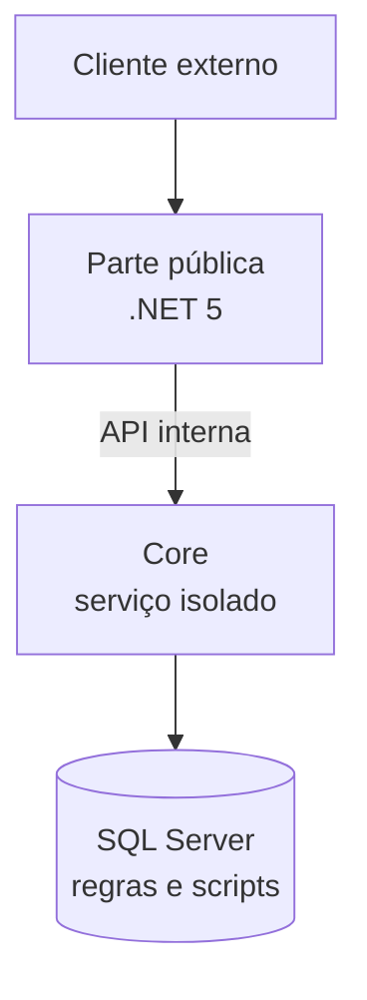

O sistema era antigo, muito usado e tinha crescido aos poucos. Do jeito que quase todo sistema cresce: uma funcionalidade de cada vez, cada uma resolvendo o problema daquele mês.

Era um projeto em ASP.NET Web Forms, da linha 4.x, nascido por volta de 2008. Uma parte ficava exposta na internet, num servidor público. O resto era o core: a parte que conversava com os dados e concentrava as regras de negócio. O time era pequeno, e o código nem estava no Git.

O objetivo era levar o sistema para o .NET 5, a versão que unificou o .NET Core e virou a base moderna da plataforma.

## Motivo 1: segurança

A parte pública autenticava por token. O problema é que esse token não rotacionava. As bibliotecas eram tão antigas que não davam suporte a rotação, e atualizar essas bibliotecas exigia atualizar o framework inteiro.

Na prática, um token vazado valia para sempre. Quem pegasse um token ganhava uma sessão que nunca expirava. E não tinha como invalidar sem derrubar quem usava o sistema de verdade.

As bibliotecas antigas não eram um problema só por causa do token. Qualquer ferramenta de SCA (análise de dependências) aponta vulnerabilidade conhecida em biblioteca sem manutenção. Num servidor interno isso já é ruim. Num servidor público, é questão de tempo.

Esse foi o motivo que tornou a migração obrigatória. Os outros já existiam havia anos, mas ficavam no "um dia a gente resolve". Segurança não espera esse dia.

## Motivo 2: infra que não acompanha

O sistema não conseguia ir para uma arquitetura de nuvem moderna. CI, build automático, infraestrutura como código (IaC), deploy previsível: tudo o que hoje é o mínimo estava fora de alcance.

O deploy era manual. Uma pessoa entrava numa VM remota, compilava o projeto ali mesmo e copiava os arquivos para o IIS, no Windows. Cada deploy dependia de alguém lembrar de todos os passos, na ordem certa.

A gente não resolveu isso de uma vez. Foi em degraus:

1. o código foi para um repositório Git, coisa que ele nunca tinha tido;
2. o repositório foi para o Azure Repos;
3. veio um CI parcial, bem difícil de configurar;
4. o CI cresceu até cobrir o build inteiro;
5. só com o CI funcionando começou a migração de verdade, em ondas, parte por parte.

Parece burocracia, mas cada degrau tirou um risco. Sem histórico no Git, não dá para saber o que mudou. Sem CI, não dá para saber se a mudança quebrou algo. Migrar sem essas duas coisas é trocar peça no escuro.

## Motivo 3: código que não deixa evoluir

O código era muito antigo e estava bem bagunçado. Para modernizar, a gente precisava mudar o código com confiança. Para ter confiança, precisava de teste.

Michael Feathers, no livro Working Effectively with Legacy Code, define código legado como código sem teste. Parece provocação, mas na prática faz sentido: sem teste, você não sabe se a mudança manteve o comportamento. Toda alteração vira aposta.

A ideia de como atacar veio de lá e do Refactoring, do Martin Fowler. Primeiro cobrir o comportamento atual com teste. Depois mudar a estrutura sem mudar o comportamento. Só que o código antigo não foi feito para ser testado, então parte do trabalho foi abrir espaço para o teste existir.

O Web Forms piora isso. Ele foi feito para parecer desenvolvimento desktop: a tela tem eventos de clique, o estado vai e volta no ViewState e a lógica costuma morar no code-behind da página. A regra de negócio fica presa ao ciclo de vida da página e ao `HttpContext.Current`, um estado global. Para testar uma regra, você precisa montar uma requisição inteira.

E o Web Forms não existe no .NET Core nem no .NET 5. Não tem atualização de versão: a parte de tela precisa ser reescrita, e a `System.Web` inteira fica para trás. Como a reescrita era obrigatória, ela virou a chance de tirar a regra de negócio da página e colocar em classes que recebem as dependências por injeção, algo que o .NET novo já traz pronto.

Esse motivo quase nunca entra na lista. Não é a tecnologia nova ter recurso melhor. É o código atual não deixar você evoluí-lo com segurança.

## Motivo 4: ninguém quer trabalhar ali

O time era pequeno e precisava crescer. As entrevistas seguiam o mesmo roteiro: a pessoa ia bem, via que a tecnologia era antiga e desistia.

A gente demorou muito para conseguir alguém que ficasse no projeto. Isso não é só problema de contratação. Um sistema que só duas ou três pessoas conseguem manter é risco de negócio. Se uma delas sai, o conhecimento sai junto.

Do lado de quem está sendo entrevistado, a recusa faz sentido. A stack em que você passa os próximos anos define o que você vai saber fazer depois.

## Por que não só um proxy

Dá para perguntar: por que não colocar um proxy de segurança na frente do servidor público? O proxy cuidaria da autenticação, com token que expira e rotaciona, e o legado continuaria igual atrás dele.

Isso resolveria o token. Não resolveria nada do resto. As bibliotecas vulneráveis continuariam lá, o deploy continuaria manual, o código continuaria sem teste e a vaga continuaria sem candidato. O proxy blinda o sintoma. A dívida continua inteira.

Quando só um dos motivos aparece, um remendo pode bastar. Quando aparecem quatro de uma vez, o remendo só adia a conta.

## O que ficou sem migrar

Migrar não quer dizer migrar tudo. O core, a parte que concentrava os dados e as regras de negócio mais complexas, ficou onde estava.

Boa parte dessas regras nem estava no C#. Estava dentro do SQL Server, em stored procedures e scripts acumulados por anos. E o banco não tinha como ir para a nuvem nem entrar num CI: ele precisava continuar num servidor on-premise.

O core também não era exposto ao público, então o problema de segurança não chegava nele do mesmo jeito. Migrar aquilo seria caro e arriscado, sem ganho proporcional.

A decisão foi isolar. O core virou um serviço separado, e a parte nova passou a falar com ele só por uma API interna. A parte pública foi modernizada, e o resto ficou lá dentro, protegido.

O C# do core não era totalmente compatível com o .NET novo, mas quase. O trabalho foi trocar os conectores com o banco. As regras continuaram no SQL Server, intocadas, e o serviço não precisou de nenhuma grande migração.

## Trocar o barco navegando

Penso nessa migração como trocar as peças de um barco sem parar de navegar. O sistema não pode parar: tem gente usando todo dia. Então você troca o que dá para trocar com o barco na água.

O mastro, as velas, os móveis lá dentro: tudo isso dá para trocar navegando. O casco e o motor, não. Se você tenta trocar o casco no meio do mar, o barco afunda.

O trabalho mais importante de uma migração é essa separação, o que é casco e o que é vela. No nosso caso, a parte pública era vela. O banco e as regras dentro dele eram o casco.

Na próxima parte da série: os tipos de migração. Este caso foi uma migração parcial, e escolher entre parcial, completa ou uma camada entre o novo e o legado muda todo o resto do plano.

## Referências

* Michael Feathers, Working Effectively with Legacy Code (2004)
* Martin Fowler, Refactoring: Improving the Design of Existing Code
