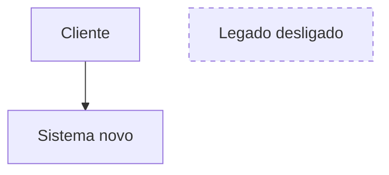
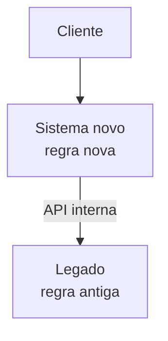
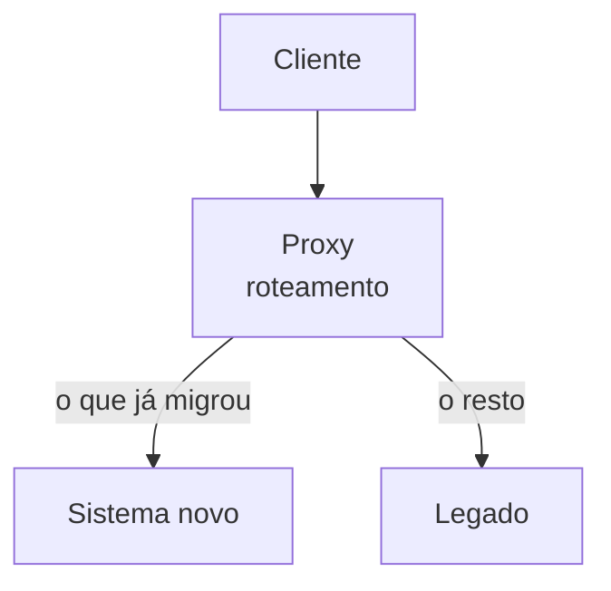
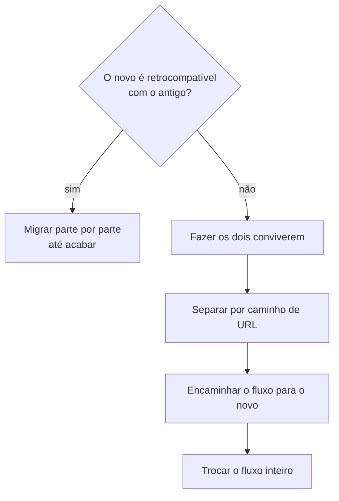

Depois de decidir migrar, a próxima pergunta é o que migrar. A resposta quase nunca é "tudo".

O que separa um tipo de migração do outro é onde fica a regra de negócio e quem é dono do contrato com quem chama de fora. Em outras palavras: onde fica a fronteira entre o novo e o legado.

## Migração completa

Tudo vai para o sistema novo e, no fim, o legado é desligado.

Eu nunca fiz uma. Mas consigo dizer quando ela vale a pena:

* o legado não tem mais onde rodar. O sistema operacional, o servidor ou o runtime saíram de suporte;
* a infra trava tudo. Sem migrar, nem nuvem dá para usar;
* o custo só sobe. Cada ano precisa de mais gente e mais infra para manter o sistema, sem nenhuma funcionalidade nova.

Nos três casos, o problema atinge o sistema inteiro. Quando só uma parte tem o problema, a completa é trabalho demais.

## Migração parcial com o novo na frente

O cliente fala só com o sistema novo. O novo tem regra própria e chama o legado como uma dependência interna, igual chamaria um banco ou outra API.

O contrato público passa a ser do novo, e o legado vira um fornecedor escondido. Quando o novo traduz o modelo antigo para o seu, essa tradução tem nome no DDD do Eric Evans: anti-corruption layer. O modelo velho não vaza para o novo.

Foi o que fizemos no caso da parte 1. A parte pública foi para o .NET 5, e o core virou um serviço isolado atrás de uma API interna. As regras ficaram no SQL Server.

## Legado atrás de um proxy

Aqui o proxy não tem regra de negócio. Ele intercepta a chamada e repassa, e quem faz o trabalho continua sendo o legado.

Esse proxy tem dois usos bem diferentes.

O primeiro é blindagem. Um proxy de segurança na frente do legado cuida de autenticação, rotação de token, rate limit e log. Nada migra. Resolve o sintoma rápido, mas a dívida fica inteira.

O segundo é o Strangler Fig, nome que o Martin Fowler deu em 2004. A figueira estranguladora nasce em cima de uma árvore, cresce em volta dela e com os anos toma o lugar dela. No software, o proxy divide o tráfego entre o legado e o novo e manda cada vez mais chamadas para o novo, até o legado ficar sem uso.

O Strangler Fig é o caminho da migração completa sem big bang. O investimento e o retorno aparecem aos poucos, sem esperar o fim da migração. É o barco da parte 1 de novo: trocar as peças sem parar de navegar.

## Como achar a fronteira

No nosso caso, quatro perguntas decidiram o que ia para o novo e o que ficava:

| Pergunta | Puxa para migrar | Puxa para ficar |
| --- | --- | --- |
| Está exposto? | fica na internet | só na rede interna |
| Vai precisar mudar? | muda com frequência | parado há anos |
| Cobra manutenção? | dá trabalho todo mês | ninguém mexe |
| Dá para validar? | tem teste ou resultado claro | ninguém sabe dizer o certo |

A parte pública marcava as quatro na coluna da esquerda. O core no banco marcava as quatro na da direita.

O difícil é o meio. Uma parte exposta mas sem como validar é a mais perigosa de migrar e a mais perigosa de deixar. Quando aparece uma dessas, ela pede teste antes de qualquer decisão.

## O novo roda o antigo?

Depois da fronteira, a pergunta é técnica: o sistema novo consegue rodar o código antigo?

Se roda, dá para trocar peça por peça. Se não roda, os dois precisam conviver: um proxy separa pelo caminho da URL, cada fluxo é encaminhado para o novo e trocado inteiro de uma vez.

No nosso caso foram as duas coisas. O C# do core era quase compatível e foi junto com pouco trabalho. O Web Forms não roda no .NET 5, então a parte de tela precisou conviver até ser trocada.

## Por onde começar

Começamos pela API SOAP e só depois fomos para os fluxos de usuário.

A API tem contrato definido: entrada, saída e um cliente que reclama na hora quando algo muda. Fluxo de usuário não tem nada disso. O contrato dele está espalhado pela tela, pelo hábito de quem usa e por regras que ninguém escreveu.

## A regra escondida

A migração dos fluxos foi a parte mais difícil. Sempre aparecia uma regra escondida no front.

Era uma validação no code-behind, um campo que mudava conforme outro, um caso que só um tipo de usuário usava. Ninguém lembrava dessas regras. O sistema novo não tinha nenhuma delas e falhava nos testes de QA, de novo e de novo.

O que resolveu foi gente, não ferramenta. Trouxemos pessoas que conheciam muito bem o sistema para testar o novo, e cada fluxo passou por um piloto antes de ir para todo mundo. O piloto achava as regras que a documentação não tinha.

Isso volta para o Michael Feathers. Código legado guarda o comportamento real, inclusive o que ninguém lembra. Quando não existe teste para descrever esse comportamento, a única fonte é quem usa o sistema todo dia.

Na próxima parte: como mapear esse comportamento antes de migrar, para a regra escondida aparecer no teste e não no QA.

## Referências

* Martin Fowler, Strangler Fig: https://martinfowler.com/bliki/StranglerFigApplication.html
* Ian Cartwright, Rob Horn e James Lewis, Patterns of Legacy Displacement: https://martinfowler.com/articles/patterns-legacy-displacement/
* Michael Feathers, Working Effectively with Legacy Code (2004)
* Michael Feathers, Brutal Refactoring: More Working Effectively with Legacy Code
* Eric Evans, Domain-Driven Design (anti-corruption layer)
